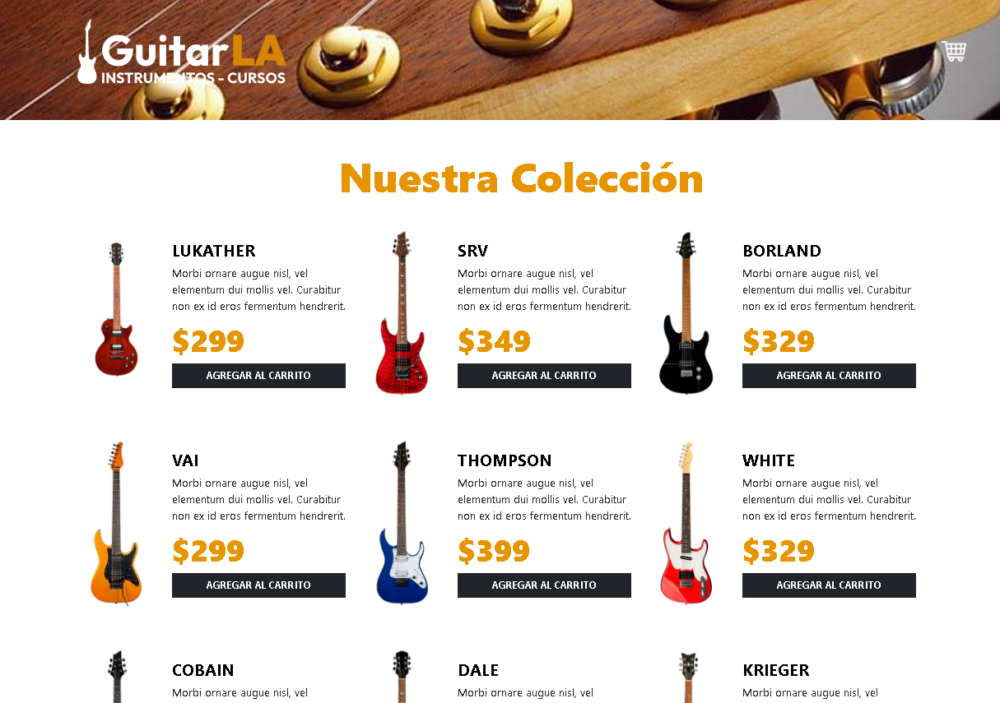
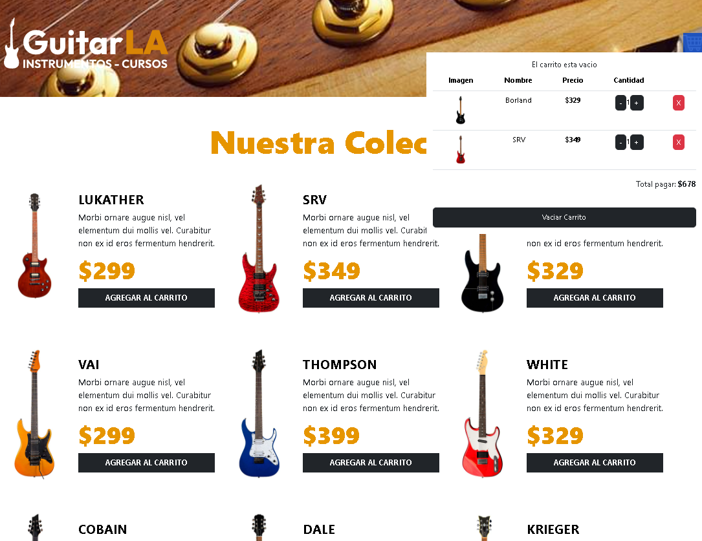

# 🎸 GuitarsLA-Ts

Tienda en línea de guitarras con carrito de compras, desarrollada con **React 19 + TypeScript + Vite**. Este documento describe la arquitectura del frontend, los hooks utilizados, los patrones aplicados y cómo ejecutar el proyecto en local.

## Índice

1. [Visión general del proyecto](#1-visión-general-del-proyecto)
2. [Ficha técnica y tecnologías](#2-ficha-técnica-y-tecnologías)
3. [Arquitectura e implementación en React](#3-arquitectura-e-implementación-en-react)
4. [Patrones, estado y persistencia](#4-patrones-estado-y-persistencia)
5. [Puesta en marcha](#5-puesta-en-marcha)
6. [Estructura del proyecto](#6-estructura-del-proyecto)

---

## 1. Visión general del proyecto

### Nombre y propósito

**GuitarsLA-Ts** es una aplicación de página única (SPA) que muestra el catálogo de una tienda de guitarras y permite al usuario armar un carrito de compras: agregar modelos, ajustar cantidades, eliminar productos, vaciar el carrito y ver el total a pagar en tiempo real.

**Problema que resuelve:** ofrece una experiencia de compra fluida sin recargar la página. El estado del carrito se conserva en el navegador, por lo que el usuario no pierde su selección al refrescar o cerrar la pestaña.

Esta versión es la migración a **TypeScript** del proyecto GuitarsLA, con el objetivo de practicar el tipado de props, de datos y la extracción de lógica a un *custom hook*.

### Capturas de pantalla

La siguiente galería muestra la vista principal del catálogo y el carrito de compras con productos seleccionados.

| Catálogo | Carrito abierto |
| --- | --- |
|  |  |

### Despliegue en producción

No hay demo activa por el momento. El proyecto se ejecuta en local (ver [Puesta en marcha](#5-puesta-en-marcha)).

---

## 2. Ficha técnica y tecnologías

### Lenguajes

| Lenguaje | Versión | Notas |
| --- | --- | --- |
| TypeScript | `~6.0.2` (instalada: 6.0.3) | Tipado de datos y props mediante declaraciones globales en `src/types.d.ts`. Target `ES2023`. |
| JavaScript | ES2023 (salida del compilador) | Módulos ES (`"type": "module"`). |
| HTML5 / CSS | — | Marcado semántico en JSX. Las clases de estilo siguen la nomenclatura de Bootstrap 5 (`container-xl`, `row`, `btn`, `col-md-*`). |

**Nivel de tipado:** moderado. Los datos (`Guitar`, `CartItem`) y las props de los componentes (`GuitarProps`, `CartProps`) están tipados explícitamente. En `tsconfig.app.json` no está activado `strict`, por lo que algunos parámetros dentro del hook `useCart` todavía se infieren como `any` (ver [Mejoras pendientes](#mejoras-pendientes)).

### Framework y UI

| Paquete | Versión declarada | Uso |
| --- | --- | --- |
| `react` | `^19.2.8` | Biblioteca de UI |
| `react-dom` | `^19.2.8` | Renderizado en el DOM (`createRoot`) |
| `@vitejs/plugin-react` | `^6.1.1` | Soporte de JSX y Fast Refresh en Vite |

**Estilos:** el JSX usa clases con nomenclatura de **Bootstrap 5**. El archivo `src/index.css` está vacío y el proyecto no incluye Bootstrap como dependencia ni vía CDN, por lo que para ver el diseño completo hay que añadirlo (ver [Mejoras pendientes](#mejoras-pendientes)).

### Entorno y tooling

| Herramienta | Versión | Rol |
| --- | --- | --- |
| Vite | `^8.3.0` | Bundler y servidor de desarrollo con HMR |
| npm | incluido con Node.js | Gestor de paquetes (`package-lock.json` incluido) |
| ESLint | `^10.10.0` | Análisis estático |
| `typescript-eslint` | `^8.69.0` | Reglas de ESLint para TypeScript |
| `eslint-plugin-react-hooks` | `^7.1.1` | Verifica las reglas de los hooks |
| `eslint-plugin-react-refresh` | `^0.5.6` | Valida compatibilidad con Fast Refresh |
| Node.js | `^20.19.0` o `>=22.12.0` | Requisito de Vite 8 |

### Dependencias clave

El proyecto es deliberadamente liviano: **solo tiene dos dependencias de producción** (`react` y `react-dom`). No usa librerías de enrutamiento, clientes HTTP ni de iconos: el catálogo es local (`src/data/db.ts`) y las imágenes son estáticas (`public/img/`).

### Scripts disponibles

| Comando | Descripción |
| --- | --- |
| `npm run dev` | Inicia el servidor de desarrollo con HMR |
| `npm run build` | Verifica tipos con `tsc -b` y genera el build de producción con Vite |
| `npm run preview` | Sirve localmente el build de producción |
| `npm run lint` | Ejecuta ESLint sobre el proyecto |

---

## 3. Arquitectura e implementación en React

### Hooks nativos

| Hook | Dónde se usa | Para qué |
| --- | --- | --- |
| `useState` | `useCart.ts` | Guarda el catálogo (`data`) y el carrito (`cart`). El carrito se inicializa de forma *perezosa* (*lazy initializer*) con una función que lee `localStorage`, para que la lectura ocurra solo en el primer render. |
| `useEffect` | `useCart.ts` | Sincroniza el carrito con `localStorage` cada vez que `cart` cambia (dependencia `[cart]`). También hay un efecto de depuración que imprime el carrito en consola. |
| `useMemo` | `useCart.ts` | Calcula `isEmpty` (`cart.length === 0`) y solo lo recalcula cuando cambia el carrito. |
| `useRef` | — | No se usa: no se requiere manipular el DOM directamente. |
| `useCallback` | — | No se usa: los manejadores se pasan a componentes baratos de renderizar, por lo que memoizarlos no aporta una mejora medible. |
| `useContext` / `useReducer` | — | No se usan: el estado vive en un único hook y se reparte por props a solo dos niveles de profundidad (ver [Gestión de estado](#estrategia-de-manejo-de-estado)). |

### Custom Hooks

#### `useCart` (`src/hooks/useCart.ts`)

**Motivo de la implementación:** separar toda la lógica del carrito (estado, reglas de negocio y persistencia) de la interfaz. Así `App.tsx` queda como un componente de composición, y los componentes visuales no conocen cómo se almacenan o calculan los datos.

**Lógica encapsulada:**

- Estado del catálogo y del carrito.
- Inicialización del carrito desde `localStorage`.
- Persistencia automática del carrito mediante `useEffect`.
- Reglas de cantidad: mínimo `1` y máximo `5` por guitarra (`min_items`, `max_items`). Al intentar reducir por debajo del mínimo, el producto se elimina del carrito.
- Cálculo del total con `reduce`.

**Valores y funciones que expone:**

| Nombre | Tipo | Descripción |
| --- | --- | --- |
| `data` | `Guitar[]` | Catálogo de guitarras |
| `cart` | `CartItem[]` | Productos en el carrito |
| `isEmpty` | `boolean` | Indica si el carrito está vacío (derivado con `useMemo`) |
| `handlerClick(item)` | función | Agrega una guitarra; si ya existe, incrementa su cantidad |
| `increaseQuantity(id)` | función | Suma una unidad (respeta el máximo de 5) |
| `decreaseQuantity(id)` | función | Resta una unidad; si llega al mínimo, elimina el producto |
| `removeFromCart(id)` | función | Elimina un producto del carrito |
| `emptyCart()` | función | Vacía el carrito |
| `calculateTotal()` | función | Devuelve el total a pagar |
| `setCart` | función | Setter del carrito (expuesto por flexibilidad) |

**Dónde se reutiliza:** se consume en `App.tsx`, que distribuye los valores a `Header` y `Guitar`. Al estar desacoplado, el hook puede reutilizarse en cualquier otra vista o probarse de forma aislada.

### Estructura de componentes

| Componente | Archivo | Tipo | Responsabilidad |
| --- | --- | --- | --- |
| `App` | `src/App.tsx` | **Inteligente (contenedor)** | Invoca `useCart`, compone la página y reparte datos y manejadores por props. |
| `Header` | `src/components/Header.tsx` | Presentacional | Muestra el logo, el carrito desplegable, la tabla de productos y el total. Recibe todo por props y emite eventos hacia arriba. |
| `Guitar` | `src/components/Guitar.tsx` | Presentacional | Tarjeta de un producto con imagen, descripción, precio y botón «Agregar al Carrito». |

`Header` y `Guitar` no guardan estado propio ni acceden a `localStorage`: solo reciben datos y llaman a las funciones recibidas. Esto facilita su reutilización y mantenimiento.

### Tipado de props e inmutabilidad

Los tipos se declaran en `src/types.d.ts` y están disponibles globalmente:

```ts
type Guitar = { id: number; name: string; image: string; description: string; price: number }

type CartItem = Guitar & { quantity: number }

type GuitarProps = { guitar: Guitar; handlerClick: (item: Guitar) => void }

type CartProps = {
  cart: CartItem[]
  decreaseQuantity: (item: number) => void
  increaseQuantity: (item: number) => void
  removeFromCart: (item: number) => void
  emptyCart: () => void
  isEmpty: boolean
  total: Number
}
```

- `CartItem` **extiende** `Guitar` mediante una intersección de tipos (`&`), evitando duplicar campos.
- El catálogo en `db.ts` está tipado como `Guitar[]`, de modo que TypeScript valida cada registro.
- **Inmutabilidad:** las operaciones `increaseQuantity`, `decreaseQuantity`, `removeFromCart` y `emptyCart` producen nuevos arreglos con `map`, `filter` y el operador *spread* en lugar de modificar el estado original, que es lo que React necesita para detectar los cambios.

---

## 4. Patrones, estado y persistencia

### Estrategia de manejo de estado

- **Estado local encapsulado en un custom hook.** Todo el estado de la aplicación (catálogo y carrito) vive en `useCart`, instanciado una sola vez en `App`.
- **Flujo de datos unidireccional:** `App` → props → `Header` / `Guitar`; los eventos regresan al padre mediante *callbacks* (`handlerClick`, `increaseQuantity`, etc.).
- **Estado derivado en lugar de duplicado:** `isEmpty` y el total se calculan a partir de `cart`, sin guardarse como estado independiente.
- **Sin Context API ni gestores externos (Redux, Zustand):** para un árbol de solo dos niveles, el *prop drilling* es mínimo y añadir una solución global sería sobreingeniería.

### Patrones y buenas prácticas aplicadas

- **Modularización por responsabilidad:** `components/` (UI), `hooks/` (lógica), `data/` (datos) y `types.d.ts` (contratos de tipos).
- **Separación de lógica y presentación** mediante el custom hook.
- **Listas con `key` estable:** se usa `guitar.id` al renderizar `data.map(...)` y `cart.map(...)`.
- **Desestructuración de props** en las firmas de los componentes.
- **Renderizado condicional** con operador ternario para alternar entre carrito vacío y tabla de productos.
- **Constantes con nombre** para las reglas de negocio (`min_items`, `max_items`).

### Persistencia en el navegador

El carrito se guarda en **`localStorage`** bajo la clave `cart`, serializado con `JSON.stringify`:

1. **Lectura (al iniciar):** `useState(initialCart)` ejecuta una sola vez una función que lee `localStorage.getItem('cart')`, la parsea con `JSON.parse` y devuelve `[]` si no hay datos.
2. **Escritura (en cada cambio):** un `useEffect` con dependencia `[cart]` ejecuta `localStorage.setItem('cart', JSON.stringify(cart))`.

Para borrar los datos guardados, usa el botón **Vaciar Carrito** o limpia el almacenamiento desde las herramientas de desarrollador del navegador.

### Estados asíncronos (loading, error, empty, success)

La aplicación **no realiza peticiones asíncronas**: el catálogo es una constante local, por lo que no existen estados `loading` ni `error`. Sí se contempla el estado **empty** del carrito mediante `isEmpty`:

| Estado | Aplica | Implementación |
| --- | --- | --- |
| `loading` | No | El catálogo es local y se carga de forma síncrona. |
| `error` | No | No hay llamadas a APIs. |
| `empty` | Sí | `isEmpty` (derivado con `useMemo`) muestra «sin guitarras» cuando el carrito no tiene elementos. |
| `success` | Sí | Se renderiza la tabla de productos con cantidades y total. |

---

## 5. Puesta en marcha

### Requisitos previos

- **Node.js** `^20.19.0` o `>=22.12.0` (se recomienda la versión LTS). Verifica con `node -v`.
- **npm** (incluido con Node.js).
- **Git**.

### Paso a paso

**1. Clonar el repositorio**

```bash
git clone <URL-DEL-REPOSITORIO>
cd GuitarsLA-Ts
```

**2. Instalar dependencias**

```bash
npm install
```

**3. Variables de entorno**

El proyecto **no requiere variables de entorno**: no consume APIs ni servicios externos.

**4. Ejecutar en modo desarrollo**

```bash
npm run dev
```

Vite mostrará la URL local, normalmente `http://localhost:5173`.

**5. (Opcional) Generar y previsualizar el build de producción**

```bash
npm run build
npm run preview
```

**6. (Opcional) Ejecutar el linter**

```bash
npm run lint
```

---

## 6. Estructura del proyecto

```
GuitarsLA-Ts/
├── public/
│   ├── img/                 # Logo, carrito y fotos de las guitarras
│   └── favicon.svg
├── src/
│   ├── components/
│   │   ├── Guitar.tsx       # Tarjeta de producto (presentacional)
│   │   └── Header.tsx       # Encabezado y carrito (presentacional)
│   ├── data/
│   │   └── db.ts            # Catálogo de guitarras (Guitar[])
│   ├── hooks/
│   │   └── useCart.ts       # Custom hook: estado y lógica del carrito
│   ├── App.tsx              # Componente contenedor
│   ├── main.tsx             # Punto de entrada
│   ├── index.css
│   └── types.d.ts           # Tipos globales (Guitar, CartItem, props)
├── eslint.config.js
├── index.html
├── package.json
├── tsconfig.json
├── tsconfig.app.json
└── tsconfig.node.json
```

---

## Mejoras pendientes

- Incluir Bootstrap 5 (`npm i bootstrap` e importarlo en `main.tsx`, o vía CDN en `index.html`) para que se aplique el diseño que ya usan las clases del JSX.
- Activar `"strict": true` en `tsconfig.app.json` y tipar los parámetros del hook `useCart`.
- Corregir las advertencias de `tsc` (variables e importaciones sin uso, y `total: Number` → `number`) para que `npm run build` finalice sin errores.
- Aplicar el límite máximo de 5 unidades también al agregar desde el catálogo (`handlerClick`).